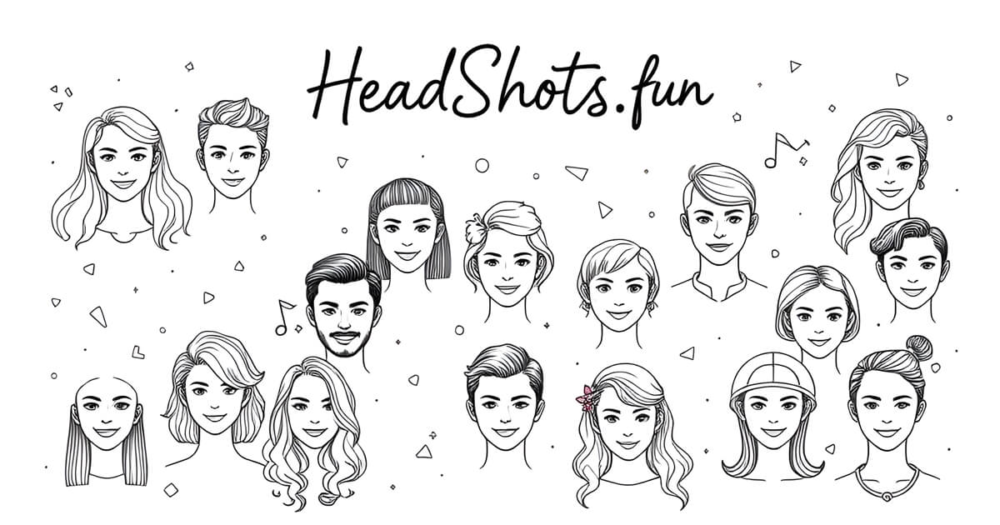

# 📸 HeadShots.fun

<div align="center">

🌍 [English](README.md) · [简体中文](README.zh-CN.md) · [日本語](README.ja.md) · [한국어](README.ko.md) · [Español](README.es.md) · [Français](README.fr.md)




<a href="https://ko-fi.com/visoar">
  
</a>

### 🎉 Nouvelle excitante : HeadShots.fun est maintenant open source !

[](https://www.gnu.org/licenses/agpl-3.0)
[](https://discord.gg/vdqwAcp7mf)
[](https://twitter.com/ullr_ai)

</div>

---

## À propos

HeadShots.fun est une plateforme SaaS propulsée par l'IA qui génère des photos de profil amusantes ou professionnelles en seulement 10 secondes. Notre objectif est de fournir des photos de profil personnalisées de haute qualité pour tous grâce à une technologie d'IA avancée et un design convivial.

## Pourquoi HeadShots.fun ?

- 🎨 **Créativité Instantanée** : Générez des photos de profil uniques en quelques secondes
- 🌈 **Personnalisation Illimitée** : Personnalisez votre image avec des outils propulsés par l'IA
- 📸 **Le Modèle d'IA le Plus Rapide** : Générez vos photos de profil en quelques secondes
- 📱 **Design Responsive** : Expérience fluide sur tous les appareils
- 💼 **Prêt pour le SaaS** : Intégré avec Stripe, prêt pour votre idée de SaaS de photos de profil
- 🌐 **Internationalisation** : Support multilingue

## Fonctionnalités Principales

- 🖼️ Génération et remplacement d'arrière-plan propulsés par l'IA
- 💡 Sélection intelligente des styles
- 🎭 Prompts personnalisés pour des expressions uniques
- 📱 Design responsive pour une expérience fluide sur tous les appareils

## Déployer avec Vercel

[](https://vercel.com/new/clone?repository-url=https%3A%2F%2Fgithub.com%2FUllrAI%2FHeadShots.fun)

## Étapes de Développement

1. Installer les dépendances avec pnpm/npm :
   ```bash
   npm install
   ```

2. Copier .env.example vers .env.local et mettre à jour les variables :
   ```bash
   cp .env.example .env.local
   ```

3. Démarrer le serveur de développement :
   ```bash
   npm run dev
   ```

## Feuille de Route

- [x] Ajouter l'internationalisation
- [ ] Refactoriser le Tableau de Bord d'Administration

## Stack Technologique

Ce projet est construit sur [next-saas-stripe-starter](https://github.com/mickasmt/next-saas-stripe-starter), un projet open source sous licence MIT. Il fournit un excellent boilerplate SaaS pour l'intégration de Next.js et Stripe. Nous exprimons notre sincère gratitude aux auteurs originaux pour leur précieuse contribution.

### Frameworks et Bibliothèques
- [Next.js](https://nextjs.org/?from=headshots.fun) – Framework React pour construire des applications performantes
- [Auth.js](https://authjs.dev/?from=headshots.fun) – Authentification sécurisée et facile à implémenter
- [Prisma](https://www.prisma.io/?from=headshots.fun) – Accès à la base de données avec sécurité des types
- [Tailwind CSS](https://tailwindcss.com/?from=headshots.fun) – CSS utilitaire pour un développement UI rapide
- [Shadcn/ui](https://ui.shadcn.com/?from=headshots.fun) – Composants UI personnalisables
- [Lucide](https://lucide.dev/?from=headshots.fun) – Ensemble d'icônes beau et cohérent

### Plateformes
- [Replicate](https://replicate.com/?from=headshots.fun) – Modèle d'IA évolutif
- [Vercel](https://vercel.com/?from=headshots.fun) – Déploiement et environnements de prévisualisation fluides
- [Resend](https://resend.com/?from=headshots.fun) – Service moderne de livraison d'e-mails
- [Neon](https://neon.tech/?from=headshots.fun) – Postgres serverless pour une mise à l'échelle sans effort
- [Stripe](https://stripe.com/?from=headshots.fun) – Traitement sécurisé des paiements
- [Cloudflare R2](https://developers.cloudflare.com/r2/?from=headshots.fun) – Stockage d'objets
- [PixMiller](https://pixmiller.com/?from=headshots.fun) – Prétraitement d'images, suppression d'arrière-plan

## Open Source

Nous sommes ravis d'annoncer que HeadShots.fun est maintenant open source !
En respectant la licence, les développeurs peuvent contribuer, personnaliser et étendre la plateforme.

Si vous avez besoin de support professionnel, comme des services de déploiement/développement personnalisé ou de conseil technique, n'hésitez pas à nous contacter à headshots-fun@ullrai.com.

## Participez
- 🌟 Donnez une étoile à ce dépôt pour montrer votre soutien
- 👀 Explorez le code et la documentation
- 🛠️ Soumettez des issues et des pull requests
- 💬 Rejoignez notre [communauté Discord](https://discord.gg/vdqwAcp7mf) pour échanger avec d'autres développeurs
- 🐦 Suivez-nous sur [Twitter/X](https://twitter.com/ullr_ai) pour les dernières nouvelles

## Showcase
### HeadShot.cv
Professional portraits for every career stage at [HeadShot.cv](https://headshot.cv/)

## Licence
Veuillez vous assurer que le lien Powered reste dans le pied de page.
Et ensuite ce projet est publié sous [AGPL 3.0](./LICENSE.md).

> Si les principaux contributeurs sont d'accord, nous pourrions passer à une licence plus permissive dans les versions futures.

---
[HeadShots.fun](https://headshots.fun/?from=GitHub) - Amusant & Professionnel pour Toutes les Occasions, Prenez la Photo ! 